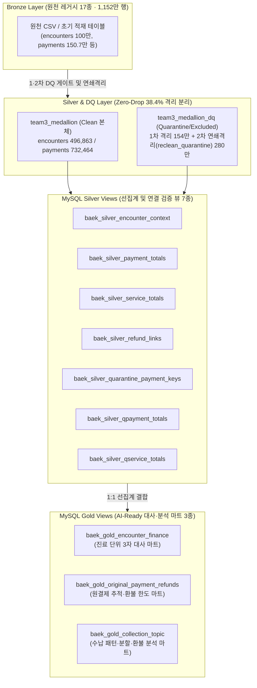

# [산출물 2] AI Ready Data TO-BE 모델링 명세서

**문서 번호**: DELIV-02-TOBE-MODELING  
**버전**: v1.1.0 (최종 MySQL 8.4 View 및 38.4% 연쇄 격리 반영)  
**대상 DB**: MySQL 8.4 (`team3_medallion` / `team3_medallion_dq`)  
**구현 스크립트**: [`medallion_hopitalData/1015_DB에맞는_SILVERGOLD/02_build_silver.sql`](../medallion_hopitalData/1015_DB에맞는_SILVERGOLD/02_build_silver.sql), [`04_build_gold.sql`](../medallion_hopitalData/1015_DB에맞는_SILVERGOLD/04_build_gold.sql)

---

## 1. TO-BE 데이터 아키텍처 개요 (Medallion Architecture)

본 프로젝트는 원천 레거시 데이터(17종, **11,522,242행**)의 품질 결함(더미 키, 부모키 부정합, 형식 불일치)을 무손실(Zero-Drop)로 분리하고, 금액 증폭(Fan-out) 없이 진료·수납·처방 정합성을 검증하기 위해 **MySQL 8.4 기반 Medallion 레이어(Bronze → Silver → Gold)**를 구현하였다.

---

## 2. 거버넌스 및 모델링 핵심 원칙

### 2.1 기존 자산 불변의 원칙 (Immutability & Read-Only Transaction)
- **원천 및 공용 테이블 보호**: `SET SESSION autocommit = 0;` 및 `START TRANSACTION WITH CONSISTENT SNAPSHOT, READ ONLY;`를 적용하여 기존 17개 테이블을 절대 수정(`UPDATE/DELETE/ALTER`)하지 않고, `baek_silver_*` 및 `baek_gold_*` **VIEW**로만 모델링.
- **조인 증폭(Fan-out) 방지 설계**: 진료(`encounters`) 1건에 복수의 결제(`payments`)와 복수의 처방(`encounter_services`)이 1:N:M으로 연결될 때 발생하는 금액 부풀림을 막기 위해, **Silver 뷰에서 반드시 `encounter_id` 단위로 선(先)집계한 뒤 Gold 뷰에서 1:1 LEFT JOIN**하도록 정규화.

### 2.2 Zero-Drop 무손실 원칙 및 2단계 연쇄 격리 (38.4% Quarantine)
- **1차 정제**: 형식 오류, 센티널 더미 키(`_999999999`), 중복 행 등 **약 154만 건**을 `team3_medallion_dq`의 개별 `*_quarantine`, `*_excluded` 테이블로 분리 (1차 Clean `9,981,313건`).
- **2차 부모-자식 연쇄 격리 (`reclean_quarantine`)**: 상위 접수(`checkins`)·진료(`encounters`)가 격리될 경우 하위 수납·처방 데이터를 그대로 두면 고아 거래(Orphan)가 발생하므로, **약 260만~280만 건을 추가 연쇄 격리(Cascade)**하여 전체 원천 대비 **약 38.4%(약 440만 건)**를 격리 보관하고 100% 참조 무결성이 입증된 Clean 데이터만 확정.

---

## 3. MySQL 구현 레이어별 상세 명세 (Silver 7종 · Gold 3종)

### 3.1 Silver Layer Views (7종 — [`02_build_silver.sql`](../medallion_hopitalData/1015_DB에맞는_SILVERGOLD/02_build_silver.sql))

| View 물리명 | 그레인 (Grain / PK) | 주요 역할 및 변환 규칙 |
| :--- | :--- | :--- |
| `baek_silver_encounter_context` | `encounter_id` (1행) | 진료 본체에 병원·진료과·접수·예약·의사 컨텍스트를 증폭 없이 결합하고 진료 시간·상태 유효성 플래그 생성 |
| `baek_silver_payment_totals` | `encounter_id` (1행) | 진료별 정상 결제(`PAYMENT`) 합계, 환불(`REFUND`) 합계, 결제 횟수, 복합 결제수단(`method_bundle`) 선집계 |
| `baek_silver_service_totals` | `encounter_id` (1행) | 진료별 세부 처방(`encounter_services`) 금액(`unit_price * quantity - discount`) 합계 및 건수 선집계 |
| `baek_silver_refund_links` | `refund_payment_id` (1행)| 모든 환불 거래를 원결제(`original_payment_id`)와 Self-Join하여 진료 일치·시점 선후·유효 연결(`link_status`) 판정 |
| `baek_silver_quarantine_payment_keys`| `(payment_id, encounter_id)`| `payments_quarantine` 및 `reclean_quarantine`에 격리된 결제 키를 통합 추출하여 보류(Hold) 근거 추적에 활용 |
| `baek_silver_qpayment_totals` | `encounter_id` (1행) | 특정 진료에 연결된 격리 결제 건수 및 금액을 집계하여 불완전 근거(`LINKED_QUARANTINE_PRESENT`) 식별 |
| `baek_silver_qservice_totals` | `encounter_id` (1행) | 특정 진료에 연결된 격리 처방 건수를 집계하여 총진료비(`gross_charge`) 대사 보류 근거로 활용 |

### 3.2 Gold Layer Views (3종 — [`04_build_gold.sql`](../medallion_hopitalData/1015_DB에맞는_SILVERGOLD/04_build_gold.sql))

| View 물리명 | 그레인 (Grain / PK) | 주요 분석 지표 및 AI-Ready 피처 |
| :--- | :--- | :--- |
| `baek_gold_encounter_finance` | `encounter_id` (496,863행) | **[3자 재정 대사 마트]** • `recorded_net_amount` (결제합 - 환불합) • `transaction_gap` (순수납액 - `net_charge`) • `service_gap` (처방합계 - `gross_charge`) • `evidence_status` (일치 / 차액 / 격리연결 보류 상태 분류) |
| `baek_gold_original_payment_refunds`| `original_payment_id` | **[원결제 기준 환불 한도 검증 마트]** • 원결제 1건당 누적 환불 건수 및 누적 환불액 합산 • `over_limit_flag` (누적 환불액 > 원결제 승인액 초과 여부 검증) |
| `baek_gold_collection_topic` | `encounter_id` (496,863행) | **[수납 패턴·업무 복잡도 분석 마트]** • 단일결제 / 분할결제(`payment_rows >= 2`) / 환불발생(`refund_rows >= 1`) 분류 • 병원·진료과·시간대(08~14시)·거래월 코호트 분석용 최종 마트 |

---

## 4. 업무 복잡도 시나리오 확장 모델 (로컬 시뮬레이션 결합)

원천 DB에 수납 직원의 작업 소요시간 로그가 없는 한계를 보완하기 위해, 기존 DB 테이블을 수정하지 않고 별도의 시나리오 데이터(`ext_collection_worklogs`, `ext_booking_requests`)를 설계하여 **창구 작업 단계(2단계 ➔ 3단계 재확인 추가)에 따른 작업시간 민감도(+124.1%)**를 실험하였다.
