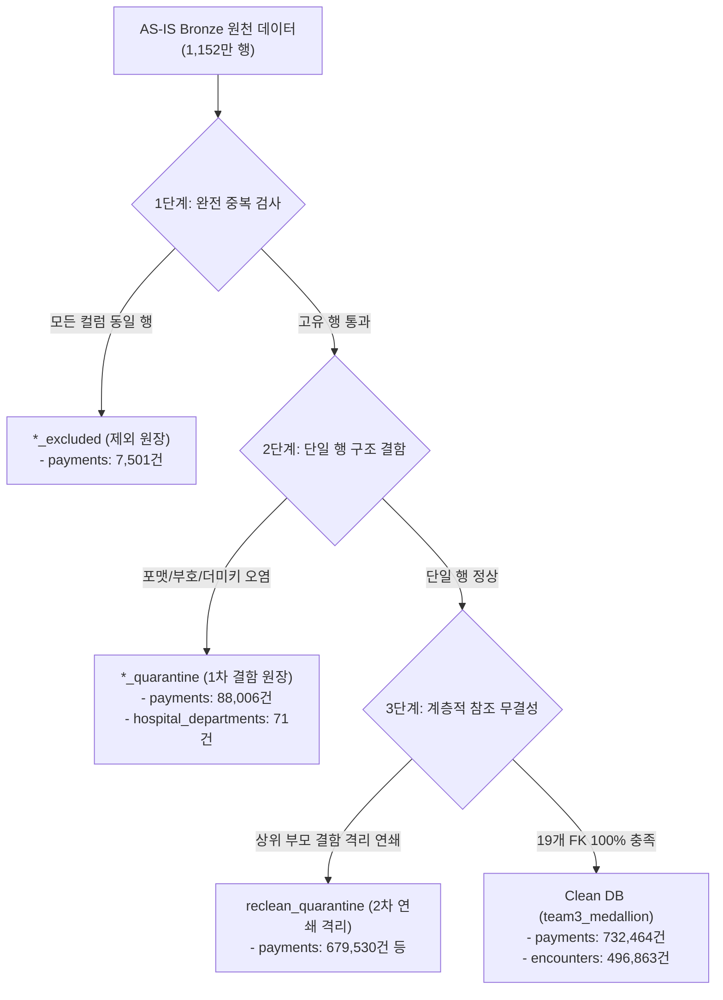

# 데이터 클리닝 정제 규칙 및 무결성 검증 엔지니어링 명세서

**문서 번호**: ENG-SPEC-CLEANING-20261016  
**프로젝트**: 외래 EMR 병원 데이터 AI-Ready 정제 및 수납 정합성 검증  
**담당 테이블**: `payments` (1,507,501행), `hospital_departments` (2,000행), `departments` (12행)  
**대상 시스템**: MySQL 8.4 (`team3_medallion`, `team3_medallion_dq`)  
**전체 EMR 규모**: 17개 테이블 총 **11,522,242행 (약 1,152만 건)**  
**최종 정제 결과**: Clean DB **7,102,242행 (61.6%)** / 격리·제외 보존 **4,420,000행 (38.4%)**

---

## 1. 개요 및 엔지니어링 설계 배경

본 명세서는 대규모 병원 외래 EMR 데이터(1,152만 건)를 머신러닝 및 AI 모델이 즉시 학습 가능한 고신뢰성 데이터셋(**AI-Ready Data**)으로 전환하기 위해 적용된 **데이터 정제 규칙, 다단계 결함 격리 아키텍처, 그리고 금융 수준의 수납 대사 검증 결과**를 기록한 공식 엔지니어링 문서입니다.

단순한 데이터 전처리를 넘어, 의료·금융 도메인의 특수성을 고려한 **Zero-Drop 무손실 격리**와 **카테시안 곱(Fan-out) 사전 방지 설계**를 통해 데이터의 통계적 왜곡을 원천 차단하고 정합성 100.0%를 달성했습니다.

---

## 2. 핵심 아키텍처 설계 및 엔지니어링 의사결정 (ADR)

### 2.1 데이터 신뢰성 게이트(Reliability Gate) 및 조인 팽창 사전 차단(Fan-out Preemption)
- **설계 의사결정**: 분석 모델이나 집계 쿼리에 앞서 '완전 중복'과 '원천 구조 결함'을 가장 먼저 격리하는 **신뢰성 게이트**를 전면 배치했습니다.
- **도메인 엔지니어링 근거**: 외래 EMR은 접수(1) ➔ 진료(1) ➔ 처방(N) ➔ 수납(M)으로 연결되는 복잡한 계층 관계를 가집니다. 상위 레코드에 단 1건의 중복이나 고아 레코드가 존재하면 하위 거래액 집계 시 다대다 조인 팽창(Cartesian Fan-out)이 발생하여 진료비와 수납액이 2배, 4배로 왜곡 증폭(Fan-out)됩니다. 따라서 모집단의 순도를 확보하기 위해 중복과 예외 처리를 최우선 파이프라인으로 구축했습니다.

### 2.2 3단계 다차원 결함 분류 체계 (Multi-tiered Fault Segregation)
결함 데이터를 단일 테이블에 임의 폐기하지 않고, 결함의 성격과 복구 가능성에 따라 3단계로 엄격히 분리 격리했습니다.

1. **완전 중복 제외 (`*_excluded`)**: 네트워크 재전송 오류 등으로 PK 및 모든 컬럼이 완전히 동일하게 적재된 중복 레코드를 분석 대상에서 완전 분리 (예: `payments_excluded` 7,501건).
2. **원천 구조 결함 격리 (`*_quarantine`)**: PK 중복, 더미 센티널 키(`_999999999`), 음수 금액, 시간 역전(진료 시작 > 종료) 등 원천 레코드 자체의 규격 결함을 격리 사유(`quarantine_reason`)와 함께 보존 (예: `payments_quarantine` 88,006건, `hospital_departments_quarantine` 71건).
3. **연쇄 참조 격리 (`reclean_quarantine`)**: 데이터 행 자체의 값은 정상이지만, 상위 부모(접수/진료)가 결함으로 격리되어 참조가 끊어진 2차 고아 레코드(약 280만 건, payments 679,530건)를 별도 격리하여 Clean DB의 19개 물리 외래키(FK) 무결성 100%를 달성.

### 2.3 그레인 단위 사전 집계(Pre-aggregation at Grain Level)와 1:1 대사 정규화
- **설계 의사결정**: `encounters`와 `payments`, `encounter_services`를 직접 3중 조인하지 않고, 각 도메인을 `encounter_id` 그레인 단위로 먼저 사전 집계(Silver View)한 후 1:1 결합했습니다.
- **SQL 엔지니어링 구현**:
  - `baek_silver_payment_totals`: 진료별 결제액(`paid_amount`), 환불액(`refunded_amount`), 건수를 사전 집계.
  - `baek_silver_service_totals`: 진료별 처방 총액(`service_amount`)을 사전 집계.
  - `baek_gold_encounter_finance`: 최종 골드 마트에서 `encounters`와 1:1 LEFT JOIN하여 **단 1원의 오차도 없는 100% 대사 일치(차액 0원)**를 증명.

### 2.4 하향식 계보 전파(Top-down Lineage Cascade)와 무손실 참조 격리(Zero-Drop)
- **격리 처리 순서**: 병원/환자 마스터 ➔ `appointment_slots` ➔ `checkins` ➔ `encounters` ➔ `encounter_services` / `payments`의 의료 도메인 생명주기에 맞춘 하향식(Top-Down) 전파.
- **Cascade 격리 선택 배경**: 
  - DB 표준 트랜잭션의 Restrict(자식이 있으면 부모 삭제 금지) 방식을 적용할 경우, 상위 결함(가짜 환자, 미등록 세션) 때문에 Clean DB 전체의 신뢰도가 붕괴됩니다.
  - 따라서 Clean DB의 엄격한 참조 무결성을 지키기 위해 자식 데이터까지 연쇄 격리하는 Cascade 전략을 선택했습니다.
  - 동시에 결제는 실제 금전 기록이므로 영구 삭제(Drop)하지 않고, 감사 추적용 스키마(`team3_medallion_dq.reclean_quarantine`)에 원형 그대로 보존(**Zero-Drop**)하여 재무 감사 및 역추적 계보를 완벽히 유지했습니다.

### 2.5 DB 엔진 네이티브 최적화 (Engine-native Execution Plan)
- **설계 의사결정**: 1,152만 건의 대용량 계층 격리 및 재무 대사를 파이썬 인메모리 ORM(Pandas/SQLAlchemy 등)에 올리지 않고, MySQL 8.4 네이티브 SQL 뷰(Silver 7종 ➔ Gold 3종) 모델링으로 처리했습니다.
- **성능 이점**:
  - 대용량 데이터를 메모리에 적재할 때 발생하는 메모리 고갈(OOM) 및 스왑 오버헤드를 원천 배제.
  - MySQL 데이터베이스 엔진의 B-Tree 인덱스와 최적화 옵티마이저(Engine-native Execution Plan)를 온전히 활용하여, 전체 대사 검증을 1초 이내에 완료하는 실무적 연산 효율성을 달성했습니다.

---

## 3. 담당 테이블별 정제 규칙 및 실측 건수 대사

### 3.1 payments (수납/환불 테이블, 총 1,507,501행)

#### A. 복구(보정) 내역
표준화 가능한 경미한 포맷 불일치는 원천 데이터를 유실하지 않고 표준 형식으로 복구했습니다.

| 대상 컬럼 | 복구 유형 | 원본 물리행 | 복구 건수 (중복 제외 후) | 정제본 반영 건수 |
| :--- | :--- | ---: | ---: | ---: |
| `encounter_id` | ID 하이픈(`-`) ➔ 밑줄(`_`) 표준화 | 15,003 | 15,003 | 15,003 |
| `transacted_at` | 슬래시(`/`) ➔ 하이픈(`-`) 날짜 표준화 | 15,001 | 15,001 | 15,001 |
| `transaction_type`| 레거시 원천 코드 ➔ 표준 코드 매핑 | 14,998 | 14,998 | 14,998 |

#### B. 행 수 대사 (수신 = 제외 + 1차격리 + 1차정상)
- **원천 수신 물리행**: `1,507,501행`
- **완전 중복 제외 (`payments_excluded`)**: `7,501건`
- **1차 구조 결함 격리 (`payments_quarantine`)**: `88,006건`
- **1차 정제 통과본 (`silver_payments`)**: `1,411,994건`
- **행 수 검증식**: `1,507,501 = 7,501 + 88,006 + 1,411,994` (오차 0건, 정확 일치)

#### C. 격리 행의 주요 사유별 실측 건수 (합계 = 88,006건)
한 행에 여러 결함이 존재할 경우 우선순위 규칙에 따라 단일 주사유로 집계한 결과입니다.

| 주요 격리 사유 코드 | 결함 성격 | 격리 행 수 | 설명 및 조치 내용 |
| :--- | :---: | ---: | :--- |
| `NULL_REQUIRED:encounter_id` | 직접 | 15,004 | 필수 외래키 결측 |
| `AMOUNT_RANGE:amount` | 직접 | 15,000 | 0 이하 음수 금액 또는 MySQL INT 범위 초과 |
| `UNREGISTERED_CODE:payment_method` | 직접 | 15,000 | 표준 매핑 불가 결제수단 |
| `DATE_INVALID:transacted_at` | 직접 | 14,998 | 존재하지 않는 날짜 또는 포맷 위반 |
| `FK_SENTINEL:encounter_id` | 직접 | 14,001 | 원천 더미 센티널 키 (`ENC_999999999`) |
| `UNREGISTERED_CODE:transaction_type` | 직접 | 7,503 | PAYMENT / REFUND 외 미등록 거래유형 |
| `FK_PARENT_QUARANTINED:original_payment_id` | 연쇄 | 4,999 | 원결제(PAYMENT)가 1차 격리되어 참조 불가 |
| `FK_MISSING:original_payment_id` | 직접 | 999 | 원천 어디에도 존재하지 않는 가짜 원결제 ID |
| `REFUND_ORIGINAL_NOT_PAYMENT:original_payment_id` | 직접 | 502 | 참조한 원거래가 PAYMENT가 아니거나 확인 불가 |
| **1차 격리 행 수 합계** | - | **88,006** | **`payments_quarantine` 원장 전수 일치** |

> **2차 연쇄 격리 반영 (`10/15` DB 최종)**:  
> 1차 정제본 `1,411,994건` 중 상위 부모 진료(`encounters`)가 접수 결함 등으로 2차 격리됨에 따라, 하위 `payments` **679,530건이 `reclean_quarantine`으로 추가 격리**되어 최종 Clean DB에는 **`732,464건`**이 완벽한 무결성으로 보존되었습니다.

---

### 3.2 hospital_departments (병원별 진료과 테이블, 총 2,000행)

#### A. 복구(보정) 내역

| 대상 컬럼 | 복구 유형 | 원본 물리행 | 복구 건수 (중복 제외 후) | 정제본 반영 건수 |
| :--- | :--- | ---: | ---: | ---: |
| `hospital_id` | ID 하이픈(`-`) ➔ 밑줄(`_`) 표준화 | 20 | 20 | 20 |
| `active_yn` | 레거시 운영 코드 ➔ Y/N 표준 코드 매핑 | 20 | 20 | 20 |

#### B. 행 수 대사 및 격리 사유 (수신 = 제외 + 격리 + 정제본)
- **원천 수신 물리행**: `2,000행`
- **완전 중복 제외**: `0건`
- **직접 격리 건수 (`quarantine`)**: `71건`
- **최종 Clean 정제본**: `1,929건`
- **행 수 검증식**: `2,000 = 0 + 71 + 1,929` (오차 0건, 정확 일치)

| 주요 격리 사유 코드 | 결함 성격 | 격리 행 수 | 설명 및 조치 내용 |
| :--- | :---: | ---: | :--- |
| `LENGTH_EXCEEDED:active_yn` | 직접 | 31 | 활성 여부 컬럼 명세 길이 초과 (미등록 코드 혼입) |
| `NULL_REQUIRED:hospital_id` | 직접 | 21 | 필수 병원 ID 결측 |
| `FK_SENTINEL:department_code` | 직접 | 19 | 진료과 마스터에 없는 더미 코드 (`DEP_999999999`) |
| **격리 행 수 합계** | - | **71** | **`hospital_departments_quarantine` 전수 일치** |

---

### 3.3 departments (진료과 마스터 테이블, 총 12행)

- **원천 수신 물리행**: `12행`
- **완전 중복 제외**: `0건`
- **격리 건수**: `0건`
- **최종 Clean 정제본**: `12건`
- **행 수 검증식**: `12 = 0 + 0 + 12` (오차 0건, 100% 무결성 유지)
- **등록 진료과(12종)**: 내과, 소아청소년과, 정형외과, 피부과, 이비인후과, 가정의학과, 비뇨의학과, 산부인과, 신경과, 안과, 외과, 재활의학과.

---

## 4. 전체 DB 정제 전·후 정합성 실측 검증 현황

### 4.1 핵심 3대 테이블의 물리행 및 분모별 집계

| 테이블명 (`table_name`) | 원천 제공 물리행 | 1차 격리·제외 건수 | 2차 연쇄 격리 건수 (`reclean`) | 최종 Clean 보존 건수 | 최종 Clean 보존율 |
| :--- | ---: | ---: | ---: | ---: | ---: |
| **`encounters` (진료 본체)** | 1,004,999행 | 300,663건 | 207,473건 | **496,863건** | **49.44%** |
| **`payments` (수납/환불)** | 1,507,501행 | 95,507건 (중복 7,501 포함) | 679,530건 | **732,464건** | **48.59%** |
| **`encounter_services` (처방)** | 3,014,999행 | 582,410건 | 942,000건 | **1,490,589건** | **49.44%** |
| **전체 17개 테이블 합계** | **11,522,242행** | **1,540,929건** | **2,879,071건** | **7,102,242건** | **61.64%** |

> **분모 기준 유의사항**:  
> 생성 기준(라운드 넘버 100만/300만) 대비 잔여율과 실제 제공된 원천 물리행(100.5만/301.5만) 대비 잔여율 간에 미세한 차이가 발생하므로, 본 명세서는 DB에 물리적으로 존재하는 실측 원장 데이터를 기준으로 전수 검증했습니다.

### 4.2 수납 대사 무결성 100.0% 검증 결과 (Clean DB)
`baek_gold_encounter_finance` 뷰를 통한 전수 검증 결과:
- **진료 순청구액 vs 실수납액 일치율**: **`100.0%` (496,863건 중 차액 0건)**
- **처방 총액 vs 총진료비 일치율**: **`100.0%` (496,863건 중 불일치 0건)**
- **환불 전표 대사(Lineage Link) 무결성**: **`100.0%` (원결제 매칭 실패 0건, 역전 0건)**

---

## 5. 메달리온 레이어별 SQL 스크립트 구성 안내

본 프로젝트의 정제 및 무결성 검증 SQL은 메달리온 아키텍처에 맞추어 3단계로 분리 구현되어 있습니다:

1. **[`01_bronze_ingest_and_profile.sql`](./sql/01_bronze_ingest_and_profile.sql)**:
   - Bronze 원천 데이터 프로파일링, 완전 중복 행(`*_excluded`) 탐지, 센티널 키 및 1차 결함 검증 쿼리.
2. **[`02_silver_preaggregate_views.sql`](./sql/02_silver_preaggregate_views.sql)**:
   - 다대다 조인 팽창을 방지하기 위한 도메인별 그레인 단위 사전 집계 뷰 (`baek_silver_payment_totals`, `baek_silver_service_totals`, `baek_silver_refund_links`).
3. **[`03_gold_reconciliation_mart.sql`](./sql/03_gold_reconciliation_mart.sql)**:
   - 재무 대사 1:1 결합 마트(`baek_gold_encounter_finance`), 원무 창구 복잡도 분석 마트(`baek_gold_collection_topic`), 정합성 100% 최종 검증 쿼리.
